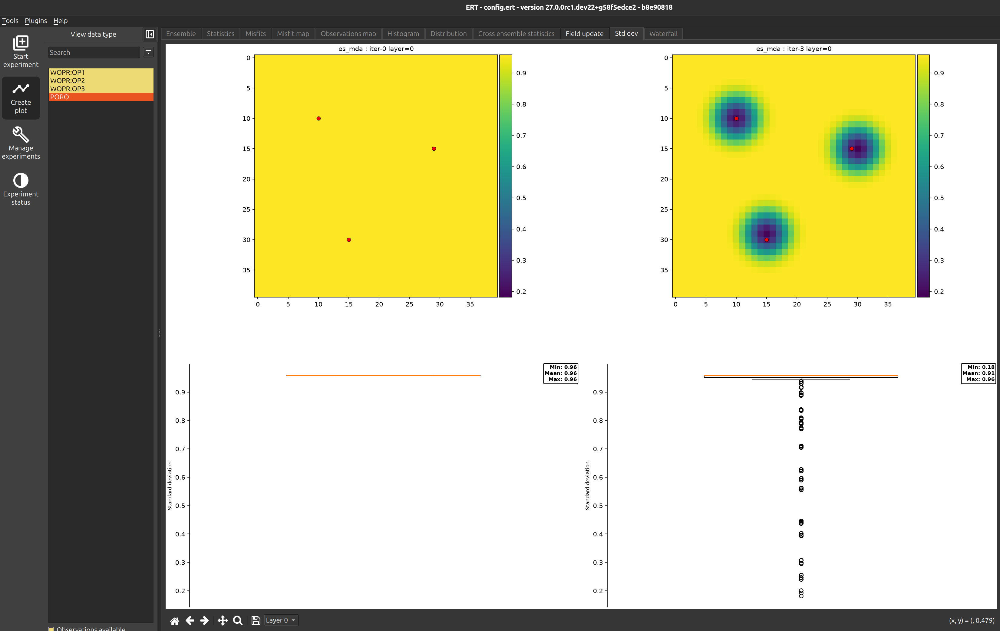
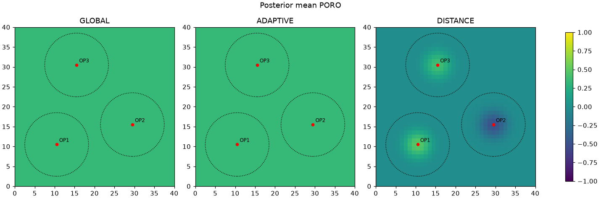
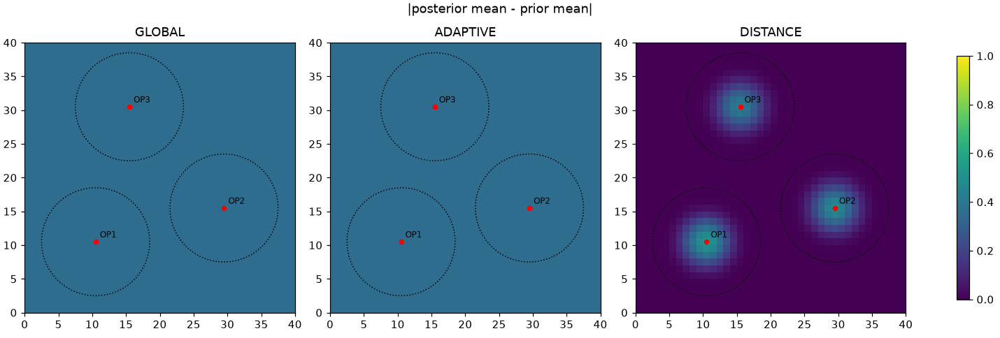
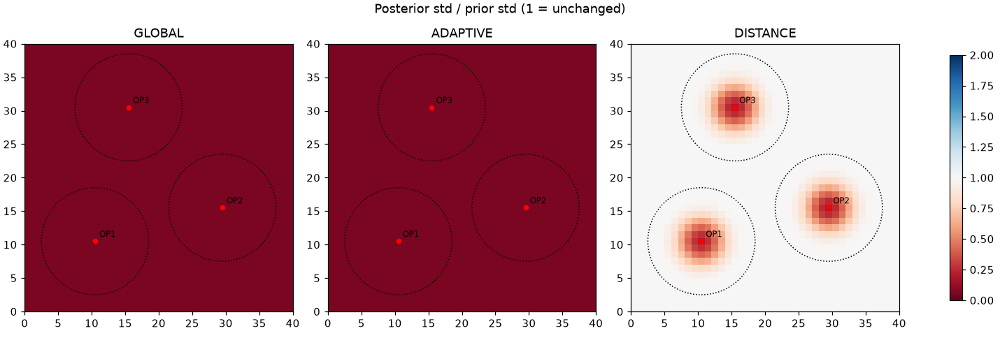
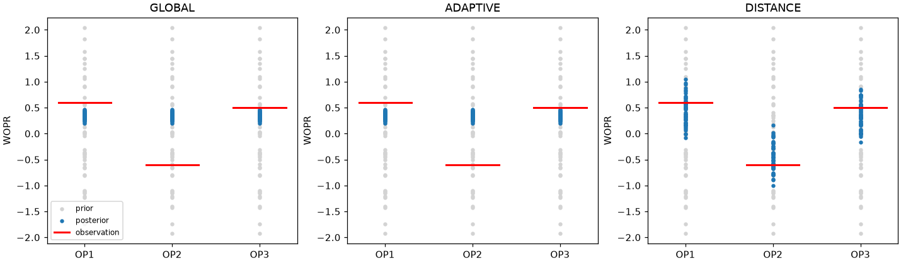
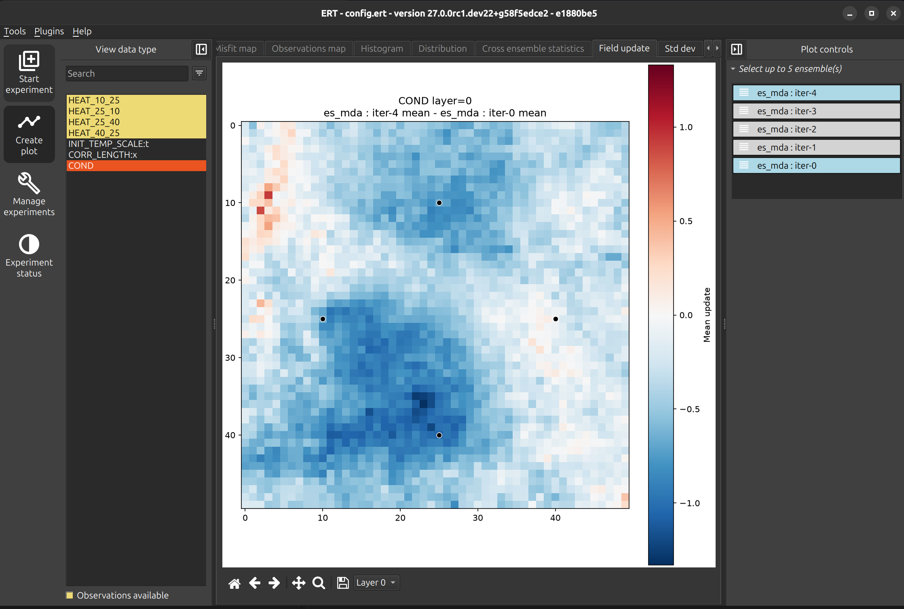
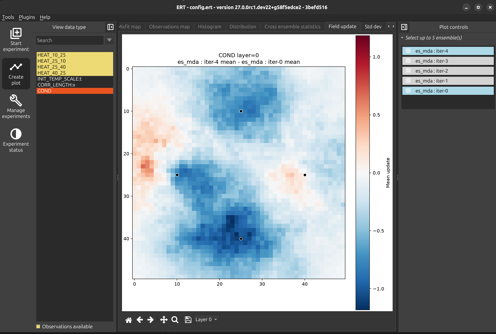
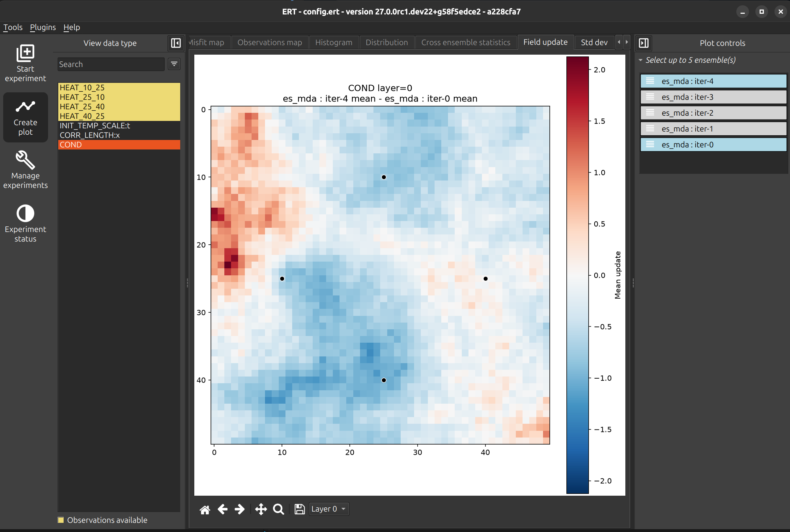

# Distance based localization in ERT

- https://ert.readthedocs.io/en/latest/getting_started/howto/distance_localization.html
- https://ert.readthedocs.io/en/latest/getting_started/howto/localization_examples.html
- https://ert.readthedocs.io/en/latest/reference/configuration/keywords.html#parameters
- https://ert.readthedocs.io/en/latest/getting_started/updating_parameters/update_parameters.html#parameter-localizations

---

# Ensemble update

- $X \in \mathbb{R}^{m \times N}$: parameters ($m$ cells, $N$ realizations)
- $Y = g(X) \in \mathbb{R}^{p \times N}$: simulated responses at the $p$ observations
- $D \in \mathbb{R}^{p \times N}$: perturbed observations

$$X^{\text{post}} = X + K\,(D - Y), \qquad K = C_{xy}\,\left(C_{yy} + \alpha\, C_D\right)^{-1}$$

$K \in \mathbb{R}^{m \times p}$ is the Kalman gain. For parameter $i$:

$$x_i^{\text{post}} = x_i + \sum_{j=1}^{p} K_{ij}\,(d_j - y_j)$$

Each realization is moved towards the observations by the misfit $d_j - y_j$, weighted by the gain $K_{ij}$: 
 - how strongly observation $j$ should move parameter $i$.

---

# Localization with the $\rho$ matrix

Damp the gain with an element-wise (Schur) product:

$$K^{\text{loc}} = \rho \circ K, \qquad x_i^{\text{post}} = x_i + \sum_{j} \rho_{ij}\,K_{ij}\,(d_j - y_j)$$

$\rho_{ij} \in [0, 1]$ is the influence of observation $j$ on parameter $i$. In ERT (`DISTANCE`) $\rho$ is built from distances in the grid layer:

$$\rho_{ij} = \mathrm{GC}\!\left(\frac{d_{ij}}{r_j}\right), \qquad d_{ij} = \lVert \text{cell}_i - \text{obs}_j \rVert, \quad r_j = \texttt{RADIUS}$$

---

# localization

| Strategy | $\rho_{ij}$ |
|---|---|
| `GLOBAL` | $1$ for all $i, j$ |
| `ADAPTIVE` | $1$ if $\lvert\mathrm{corr}(x_i, y_j)\rvert$ exceeds a significance threshold, else $0$ |
| `DISTANCE` | $\mathrm{GC}(d_{ij}/r_j)$ |

---

# 101 example

ES-MDA on a uniform prior field, three update strategies

- `FIELD` update strategy: `GLOBAL`, `ADAPTIVE`, `DISTANCE`



---

# Setup

- 40 x 40 grid, 1 m cells, one `FIELD` parameter `PORO`
- Prior: spatially uniform per realization, value ~ N(0, 1), 50 realizations
- Three wells; response = mean `PORO` of the 3 x 3 cells around the well
- Observations values OP1 = 0.6, OP2 = -0.6, OP3 = 0.5 and error = 0.1 and radius = 4

```
ANALYSIS_SET_VAR PARAMETERS FIELD GLOBAL | ADAPTIVE | DISTANCE
```


---

# Posterior mean of PORO



Red dots: observations. Dotted circles: `2 x RADIUS`, where influence reaches zero.

---

# Change in ensemble mean



`GLOBAL` and `ADAPTIVE` shift the whole field. `DISTANCE` only changes cells around the wells.

---

# Ensemble spread



- `GLOBAL` and `ADAPTIVE`: spread collapses everywhere (ratio ~0.06)
- `DISTANCE`: spread reduced near the wells, unchanged (1.0) elsewhere

---

# Fit to observations



---

# Summary of results

| Strategy | Cells updated | Mean change, near wells | Mean change, far | Std ratio, near | Std ratio, far | Obs. RMSE |
|---|---|---|---|---|---|---|
| GLOBAL | 1600 / 1600 | 0.36 | 0.36 | 0.06 | 0.06 | 0.57 |
| ADAPTIVE | 1600 / 1600 | 0.36 | 0.36 | 0.06 | 0.06 | 0.57 |
| DISTANCE | 579 / 1600 | 0.08 | 0.00 | 0.86 | 1.00 | 0.15 |

Near = within `2 x RADIUS` of a well. Obs. RMSE: posterior mean response vs observed value.

---

# Takeaways

- `GLOBAL` and `ADAPTIVE` give identical results here: every cell is perfectly correlated with every response, so adaptive localization removes nothing.
- The ensemble collapses onto one value that fits no well.
- `DISTANCE` lets each well update only its own neighbourhood, so all three observations are matched and the rest of the field keeps its prior.
- Requirements: a `LOCALIZATION` block on observations and `FIELD DISTANCE`.

---

# Heat equation - adaptive



---

# Heat equation - distance



---

# Heat equation - global


