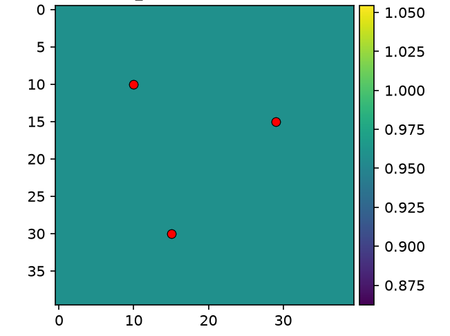
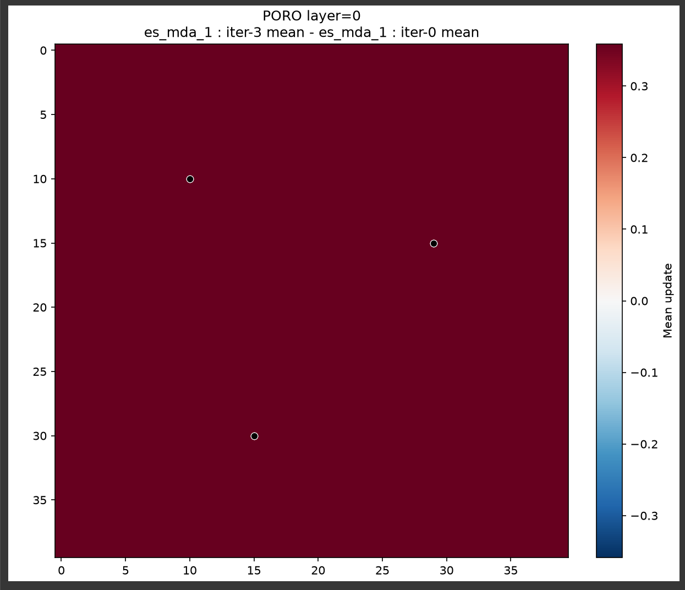
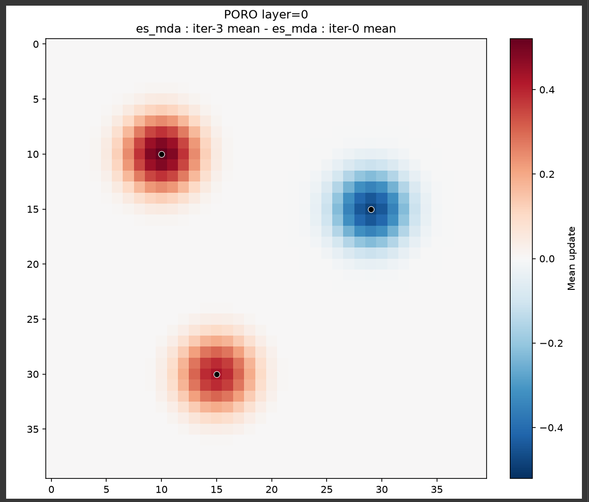

# Distance based localization in ERT

- https://ert.readthedocs.io/en/latest/getting_started/howto/distance_localization.html
- https://ert.readthedocs.io/en/latest/getting_started/howto/localization_examples.html
- https://ert.readthedocs.io/en/latest/reference/configuration/keywords.html#parameters
- https://ert.readthedocs.io/en/latest/getting_started/updating_parameters/update_parameters.html#parameter-localizations

---

# Ensemble update

- $X \in \mathbb{R}^{m \times N}$: parameters ($m$ cells, $N$ realizations)
- $Y = g(X) \in \mathbb{R}^{p \times N}$: simulated responses at the $p$ observations
- $D \in \mathbb{R}^{p \times N}$: perturbed observations

$$X^{\text{post}} = X + K\,(D - Y), \qquad K = C_{xy}\,\left(C_{yy} + \alpha\, C_D\right)^{-1}$$

$K \in \mathbb{R}^{m \times p}$ is the Kalman gain. For parameter $i$:

$$x_i^{\text{post}} = x_i + \sum_{j=1}^{p} K_{ij}\,(d_j - y_j)$$

Each realization is moved towards the observations by the misfit $d_j - y_j$, weighted by the gain $K_{ij}$: 
 - how strongly observation $j$ should move parameter $i$.

---

# Localization with the $\rho$ matrix

Damp the gain with an element-wise (Schur) product:

$$K^{\text{loc}} = \rho \circ K, \qquad x_i^{\text{post}} = x_i + \sum_{j} \rho_{ij}\,K_{ij}\,(d_j - y_j)$$

$\rho_{ij} \in [0, 1]$ is the influence of observation $j$ on parameter $i$. In ERT (`DISTANCE`) $\rho$ is built from distances in the grid layer:

$$\rho_{ij} = \mathrm{GC}\!\left(\frac{d_{ij}}{r_j}\right), \qquad d_{ij} = \lVert \text{cell}_i - \text{obs}_j \rVert, \quad r_j = \texttt{RADIUS}$$

---

# Localization strategies

| Strategy | $\rho_{ij}$ |
|---|---|
| `GLOBAL` | $1$ for all $i, j$ |
| `ADAPTIVE` | $1$ if $\lvert\mathrm{corr}(x_i, y_j)\rvert$ exceeds a significance threshold, else $0$ |
| `DISTANCE` | $\mathrm{GC}(d_{ij}/r_j)$ |

---

# Example Setup

- 40 x 40 grid, 1 m cells, one `FIELD` parameter `PORO`
- Prior: spatially uniform per realization, value ~ N(0, 1), 50 realizations
- Three wells; response = mean `PORO` of the 3 x 3 cells around the well
- Observations values OP1 = 0.6, OP2 = -0.6, OP3 = 0.5 and error = 0.1 and radius = 4

---

# Global / Adaptive localization

- They give identical results since every parameter (voxel) is correlated with every response
- The ensemble collapses onto one value

---

# Distance localization update

---

# Heat equation - adaptive

---

# Heat equation - distance

---

# Heat equation - global

